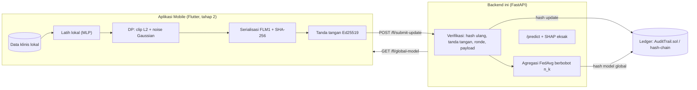

# FedCaretex Diabetes AI — Backend (FL Gateway + Blockchain + SHAP)

Backend skripsi **"Mobile Health berbasis Federated Learning, Differential Privacy, audit trail
Blockchain, dan explainability SHAP untuk deteksi dini risiko Diabetes Mellitus Tipe 2"**.

Folder ini menggabungkan dua bagian:

| Bagian | Asal | Fungsi |
|---|---|---|
| `flsys/`, `chain/`, `tests/test_*.py`, `run_experiments.py` | `../fl-diabetes-system` | Inti riset: model MLP numpy, FedAvg/FedProx, DP, Ed25519, ledger, SHAP eksak, eksperimen E1–E6 |
| `app/` | baru (gateway HTTP) | API FastAPI yang membuka inti riset itu ke aplikasi mobile |
| `scripts/simulate_clients.py`, `flsys/client.py` | baru | Klien referensi (yang nanti ditiru aplikasi Flutter) |

> [!NOTE]
> Folder `src/`, `test/`, `package.json`, `nest-cli.json`, dan sebagainya adalah scaffold NestJS lama dan **tidak dipakai** oleh backend Python ini.
> `app/ml/diabetes_model.py` (model Pima lama, fitur berbeda) juga sudah tidak dipakai lagi dan boleh dihapus.

---

## 1. Arsitektur



Satu ronde FL lewat HTTP:

1. Klien membuat keypair Ed25519 lalu memanggil `POST /fl/register-client`. `client_id = SHA-256(public key)` (pseudonim).
2. Klien memanggil `GET /fl/global-model`, lalu **wajib** mencocokkan `SHA-256(params)` dengan `hash` dan memastikan `ledger_verified = true`.
3. Klien melatih model secara lokal, menghitung `delta = w_lokal − w_global`, lalu menerapkan DP (clip + noise).
4. Klien menyerialisasi `delta` (format kanonik FLM1), menghitung SHA-256, lalu menandatangani `uint64_be(round_id) || hash`.
5. Klien memanggil `POST /fl/submit-update`. Server menghitung ulang hash dari byte yang **diterima**, memeriksa tanda tangan, ronde, duplikat, dan ukuran/NaN, lalu mencatat hash ke ledger.
6. Setelah `FL_MIN_CLIENTS` update diterima, server melakukan agregasi otomatis, mencatat hash model global ke ledger, mengevaluasi model, lalu menaikkan ronde.

---

## 2. Struktur folder

```
FedCaretex-BackendAI/
├── app/                      # Gateway HTTP (FastAPI)
│   ├── main.py               # entry point; koordinator FL dibangun saat startup
│   ├── config.py             # semua konfigurasi via environment variable
│   ├── schemas.py            # skema request/response (8 fitur dataset)
│   ├── store.py              # akun & riwayat prediksi (in-memory, demo)
│   ├── services/
│   │   ├── fl_service.py     # FLCoordinator: verifikasi, ledger, agregasi, audit
│   │   └── predict_service.py# inferensi + SHAP eksak dengan model global terbaru
│   └── routers/              # auth, predict, fl, audit, history
├── flsys/                    # Inti riset (dari fl-diabetes-system)
│   ├── data.py               # prapemrosesan (batas klinis tetap), partisi IID/Dirichlet
│   ├── model.py              # MLP 15→32→16→1 numpy (1.057 parameter), FedProx
│   ├── serialize.py          # serialisasi kanonik FLM1 + SHA-256 (harus identik di Dart)
│   ├── dp.py                 # clip L2, noise Gaussian, akuntan RDP
│   ├── identity.py           # Ed25519
│   ├── ledger.py             # SimulatedLedger & EvmLedger
│   ├── shap_exact.py         # Shapley eksak 8 fitur (256 evaluasi)
│   ├── fedlearn.py           # satu ronde FL simulasi lengkap
│   ├── experiments.py        # eksperimen E1–E6
│   └── client.py             # BARU: klien referensi protokol HTTP
├── chain/                    # Smart contract AuditTrail.sol + hasil kompilasi
├── scripts/simulate_clients.py
├── tests/                    # 37 tes flsys + tes API end-to-end
├── results/golden_hash.json  # vektor emas hash untuk uji lintas Python↔Dart
├── run_experiments.py
└── requirements.txt
```

---

## 3. Instalasi

Butuh Python 3.11+ (sudah diuji di 3.13). Node.js hanya diperlukan jika ingin mengompilasi ulang kontrak.

```bash
cd FedCaretex-BackendAI
python -m venv .venv
.venv\Scripts\activate          # Windows  (Linux/macOS: source .venv/bin/activate)
pip install -r requirements.txt

# (opsional) kompilasi ulang kontrak; chain/build/AuditTrail.json sudah tersedia
cd chain && npm install && node compile.js && cd ..
```

---

## 4. Menjalankan

### 4.1 Server API

```bash
uvicorn app.main:app --reload --port 8000
```

Dokumentasi interaktif tersedia di <http://127.0.0.1:8000/docs>.

Saat start, server memuat data evaluasi, membuat ledger, lalu menjalankan **bootstrap FL simulasi**
(`FL_BOOTSTRAP_ROUNDS` ronde, `flsys.fedlearn.run_federated`) supaya `/predict` langsung punya model.
Catatan ledger dari ronde bootstrap ikut tersimpan. Klien HTTP melanjutkan dari ronde berikutnya.

> [!IMPORTANT]
> Tanpa `DATASET_CSV`, server memakai **data sintetis** (`data_source: "synthetic"` di setiap respons).
> Hasil dari data sintetis **tidak boleh masuk naskah**. Untuk data asli:
> ```bash
> set DATASET_CSV=D:\path\diabetes_prediction_dataset.csv      # PowerShell: $env:DATASET_CSV="..."
> uvicorn app.main:app --port 8000
> ```

### 4.2 Simulasi klien (pengganti aplikasi Flutter)

Di terminal kedua, saat server berjalan:

```bash
python scripts/simulate_clients.py --clients 3 --rounds 2             # 2 ronde, 3 klien
python scripts/simulate_clients.py --clients 3 --tamper 1             # klien #1 merusak payload → ditolak
python scripts/simulate_clients.py --clients 5 --alpha 0.5            # non-IID (Dirichlet)
```

### 4.3 Blockchain sungguhan (Hardhat / Besu / Ganache)

```bash
npx hardhat node                                   # terminal terpisah
set LEDGER=evm
set LEDGER_RPC_URL=http://127.0.0.1:8545
uvicorn app.main:app --port 8000
```

`LEDGER=evm` tanpa `LEDGER_RPC_URL` memakai EVM in-process (py-evm). Kontrak di-deploy otomatis saat start.

### 4.4 Tes dan eksperimen

```bash
python -m pytest -q                                                    # flsys + API
python run_experiments.py --csv path/diabetes_prediction_dataset.csv   # E1–E6 data asli
python run_experiments.py --seeds 0 --rounds 5 --clients 5             # smoke test (sintetis)
```

---

## 5. Konfigurasi (environment variable)

| Variabel | Default | Keterangan |
|---|---|---|
| `DATASET_CSV` | *(kosong = sintetis)* | Path `diabetes_prediction_dataset.csv` untuk evaluasi server & bootstrap |
| `FL_SEED` | `0` | Seed split data & bootstrap |
| `LEDGER` | `simulated` | `simulated` (hash-chain in-memory) atau `evm` (AuditTrail.sol) |
| `LEDGER_RPC_URL` | *(kosong)* | RPC node EVM; kosong + `LEDGER=evm` artinya py-evm in-process |
| `FL_MIN_CLIENTS` | `3` | Jumlah update per ronde sebelum agregasi otomatis |
| `FL_BOOTSTRAP_ROUNDS` | `10` | Ronde FL simulasi saat start (`0` = model acak) |
| `FL_BOOTSTRAP_CLIENTS` | `5` | Jumlah klien simulasi saat bootstrap |
| `FL_ALGO` | `fedavg` | `fedavg` atau `fedprox` (dikirim ke klien) |
| `FL_PROX_MU` | `0.01` | μ FedProx (pilih di data **validasi**, lihat E4) |
| `FL_LOCAL_EPOCHS` / `FL_LR` / `FL_BATCH_SIZE` | `2` / `0.05` / `64` | Hiperparameter latih lokal |
| `DP_ENABLED` | `1` | Aktif/nonaktif DP di klien |
| `DP_CLIP_NORM` | `1.0` | Batas norma L2 (C) |
| `DP_NOISE_MULTIPLIER` | `1.0` | σ; std noise = σ·C (sama dengan default E6) |
| `DP_DELTA` | `1e-5` | δ untuk perhitungan ε |
| `RISK_LOW` / `RISK_HIGH` | `0.3` / `0.6` | Batas kategori Rendah/Sedang/Tinggi (**placeholder**, belum divalidasi) |

Seluruh konfigurasi aktif dapat dilihat di `GET /fl/status`.

---

## 6. Referensi API

### Prediksi

| Method | Endpoint | Keterangan |
|---|---|---|
| `POST` | `/predict` | Probabilitas risiko + SHAP eksak 8 fitur + rekomendasi |
| `GET` | `/history/{user_id}` | Riwayat prediksi pengguna |

Contoh request `/predict` (kategori harus persis seperti di dataset):

```json
{
  "gender": "Male", "age": 55, "hypertension": 1, "heart_disease": 0,
  "smoking_history": "former", "bmi": 31.5, "HbA1c_level": 7.0, "blood_glucose_level": 180
}
```

- `gender`: `Female` | `Male` | `Other`
- `smoking_history`: `No Info` | `never` | `former` | `current` | `not current` | `ever`

Respons memuat `probability`, `category`, `base_value`, `shap_breakdown`, `model_version`, `model_hash`, dan `data_source`.
Sifat efisiensi SHAP berlaku: `sum(shap_values) = probability − base_value`.

### Federated learning

| Method | Endpoint | Keterangan |
|---|---|---|
| `POST` | `/fl/register-client` | `{public_key}` (Ed25519 raw 32 byte, hex) → `{client_id}` |
| `GET` | `/fl/global-model` | Model global (base64 FLM1), `hash`, `ledger_verified`, konfigurasi training & DP, baseline SHAP |
| `POST` | `/fl/submit-update` | Kirim update (lihat format di bawah) |
| `POST` | `/fl/aggregate` | Paksa agregasi walau update < `FL_MIN_CLIENTS` (demo) |
| `GET` | `/fl/status` | Ronde berjalan, update tertunda, ledger, konfigurasi |
| `GET` | `/fl/history` | Metrik per ronde (val/test AUC & F1) |
| `GET` | `/fl/anomalies` | Daftar update yang ditolak beserta alasannya |

Body `POST /fl/submit-update`:

```json
{
  "client_id": "<hex SHA-256(public key)>",
  "round_id": 11,
  "num_examples": 1200,
  "payload_b64": "<base64 FLM1 dari DELTA setelah DP>",
  "hash": "<hex SHA-256(payload)>",
  "signature": "<hex Ed25519(uint64_be(round_id) || bytes(hash))>"
}
```

Kode penolakan: `unregistered_client` (403), `stale_round` / `duplicate_update` / `ledger_rejected` (409),
`integrity_failed` / `bad_payload` (422), `bad_encoding` / `bad_num_examples` (400).

### Audit (blockchain)

| Method | Endpoint | Keterangan |
|---|---|---|
| `GET` | `/audit/{round_id}` | Hash update semua klien + hash model global di ronde tersebut (+ `chain_valid` untuk ledger simulasi) |
| `GET` | `/audit/verify?round_id=&hash=[&client_id=]` | Cocokkan hash dengan ledger |

---

## 7. Kontrak untuk aplikasi Flutter (harus identik byte-per-byte)

| Hal | Spesifikasi |
|---|---|
| Fitur & urutan | `gender, age, hypertension, heart_disease, smoking_history, bmi, HbA1c_level, blood_glucose_level` |
| Encoding (15 kolom) | 4 numerik Min-Max dengan **batas klinis tetap** (`flsys/data.py::FEATURE_BOUNDS`, nilai di luar batas di-clip) + 2 biner + one-hot gender (3) + one-hot smoking (6) |
| Model | MLP 15→32→16→1, ReLU, sigmoid; urutan flat `W1,b1,W2,b2,W3,b3`, W row-major |
| Serialisasi | `"FLM1"` + `uint32 LE n` + `n × float32 LE` |
| Hash | SHA-256 atas seluruh byte; uji dengan `results/golden_hash.json` |
| Tanda tangan | Ed25519 atas `uint64 big-endian(round_id) ‖ 32 byte hash` |
| SHAP | Shapley eksak 2⁸ koalisi; fitur di luar koalisi memakai `shap_baseline` dari server |

Implementasi referensinya ada di [`flsys/client.py`](flsys/client.py).

---

## 8. Keputusan desain & batasan (penting untuk naskah)

- **Model numpy murni, bukan TFLite.** Arsitektur yang sama bisa ditulis ulang di Dart untuk inferensi, SHAP, dan training on-device.
- **Batas Min-Max klinis tetap.** Server tidak perlu (dan tidak tahu) statistik data klien. **Verifikasi `FEATURE_BOUNDS` terhadap CSV asli.**
- **ε DP** dihitung dengan RDP mekanisme Gaussian, sensitivitas = C, tanpa amplifikasi subsampling (konservatif). Sebutkan δ dan asumsi ini di naskah.
- **Server tidak bisa membuktikan klien benar-benar menerapkan DP.** Nilai `client_epsilon` mengasumsikan klien jujur.
- **Hash + tanda tangan mendeteksi modifikasi/pemalsuan**, bukan *poisoning* yang di-hash dengan benar. Agregasi saat ini FedAvg biasa (belum robust).
- **Bootstrap** adalah FL *simulasi* di server agar demo langsung berfungsi. Pada deployment nyata, set `FL_BOOTSTRAP_ROUNDS=0` atau muat model hasil eksperimen.
- **State in-memory.** Restart server mengulang ronde & ledger simulasi. Akun memakai password plaintext (demo saja).
- **Kategori risiko** (`RISK_LOW`/`RISK_HIGH`) adalah placeholder dan perlu dipilih di data validasi.

## 9. Belum dikerjakan

- Port Dart (model, DP, serialisasi, Ed25519, SHAP) di `FedCaretex-Mobile`, diuji terhadap `golden_hash.json`
- Persistensi model global + ledger (saat ini in-memory)
- Autentikasi token pada endpoint FL, rate limiting
- Agregasi robust (trimmed mean / median) dan deteksi anomali update
- Pemilihan threshold risiko di data validasi, validasi eksternal (Pima), adapter Flower
